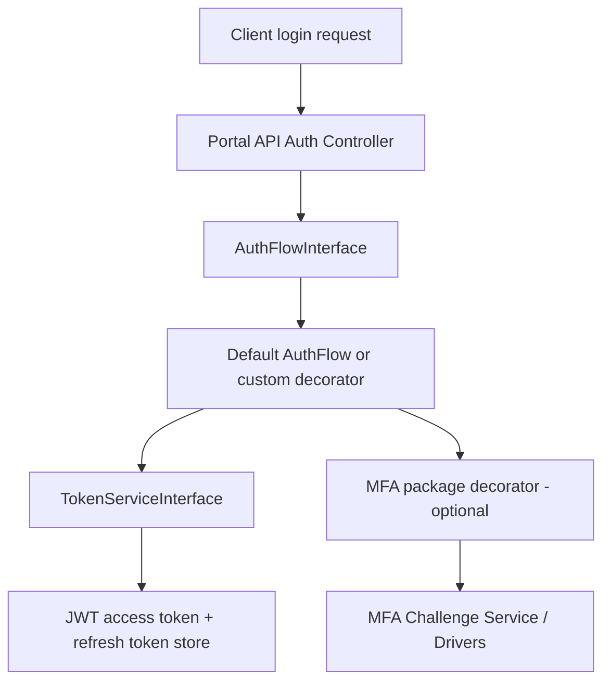

# Authentication

This section documents authentication and MFA across NinjaPortal packages.

NinjaPortal authentication is split across two layers:

- **`ninjaportal/portal-api`** for authentication endpoints, token lifecycle, guards, and auth-flow extension points
- **`ninjaportal/portal-mfa`** for MFA challenges, factor management, and MFA driver extensibility

## What this section covers

- consumer/admin authentication contexts
- JWT access tokens and opaque refresh tokens
- auth flow extension (`AuthFlowInterface`)
- MFA flows and endpoints
- MFA drivers (authenticator app + email OTP)
- adding custom MFA drivers

## Recommended reading order

1. [Portal API: Authentication & Tokens](/portal-api/auth-tokens)
2. [Portal API: Auth Flow Extensibility](/portal-api/extending)
3. [Portal MFA Overview](/portal-mfa/)
4. [Portal MFA / Flows & Endpoints](/portal-mfa/flows)
5. [Portal MFA / Drivers & Extensibility](/portal-mfa/drivers)

## Architecture view

## Related sections

- [Portal API Overview](/portal-api/)
- [Portal API / How to Extend](/portal-api/extending)
- [Portal MFA Overview](/portal-mfa/)

