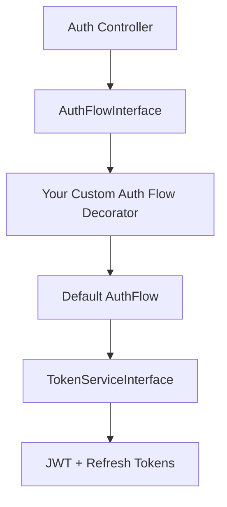

# Add Custom Auth Flow

This guide shows how to customize authentication behavior in `ninjaportal/portal-api` by replacing or decorating `AuthFlowInterface`.

## Why use `AuthFlowInterface`?

Portal API controllers depend on `AuthFlowInterface`, not a concrete class.

That means you can change login/refresh/logout behavior without forking the controllers.

Common use cases:

- SSO enforcement
- domain-based login restrictions
- risk checks / step-up rules
- custom auditing or rate-limit orchestration

## Recommended approach: decorate the existing flow

Decorating the default flow keeps built-in behavior intact and lets you add your custom logic before/after delegation.

## Flow diagram



## Example: custom auth flow decorator

```php
namespace App\Auth;

use Illuminate\Contracts\Auth\Authenticatable;
use NinjaPortal\Api\Contracts\Auth\AuthFlowInterface;

class CustomAuthFlow implements AuthFlowInterface
{
    public function __construct(private AuthFlowInterface $inner) {}

    public function attemptLogin(string $email, string $password, string $context): array
    {
        if ($context === 'admin' && str_ends_with(strtolower($email), '@corp.example')) {
            throw \Illuminate\Validation\ValidationException::withMessages([
                'email' => ['Use enterprise SSO for this account.'],
            ]);
        }

        return $this->inner->attemptLogin($email, $password, $context);
    }

    public function issueForUser(Authenticatable $user, string $context): array
    {
        return $this->inner->issueForUser($user, $context);
    }

    public function refresh(string $refreshToken, string $context): array
    {
        return $this->inner->refresh($refreshToken, $context);
    }

    public function logout(string $refreshToken, string $context): void
    {
        $this->inner->logout($refreshToken, $context);
    }
}
```

## Bind your custom flow

```php
use App\Auth\CustomAuthFlow;
use NinjaPortal\Api\Auth\AuthFlow;
use NinjaPortal\Api\Contracts\Auth\AuthFlowInterface;

$this->app->bind(AuthFlowInterface::class, function ($app) {
    return new CustomAuthFlow($app->make(AuthFlow::class));
});
```

## If you use MFA (optional extension)

If an auth extension package (such as `ninjaportal/portal-mfa`) already overrides `AuthFlowInterface`, decorate that package's flow instead of binding directly to the default `AuthFlow`.

The rule is the same:

- decorate the currently active flow implementation
- preserve the interface contract

## Testing checklist

- consumer login success/failure paths
- admin login success/failure paths
- refresh/logout behavior still works
- auth event/audit expectations (if you rely on them)
- Scribe examples/docs still reflect your actual auth contract if changed

## Related docs

- [Introduction / Authentication & Authorization](/introduction/authentication-authorization)
- [Portal API / Authentication & Tokens (Reference)](/portal-api/auth-tokens)
- [Portal API / How to Extend (Reference)](/portal-api/extending)

