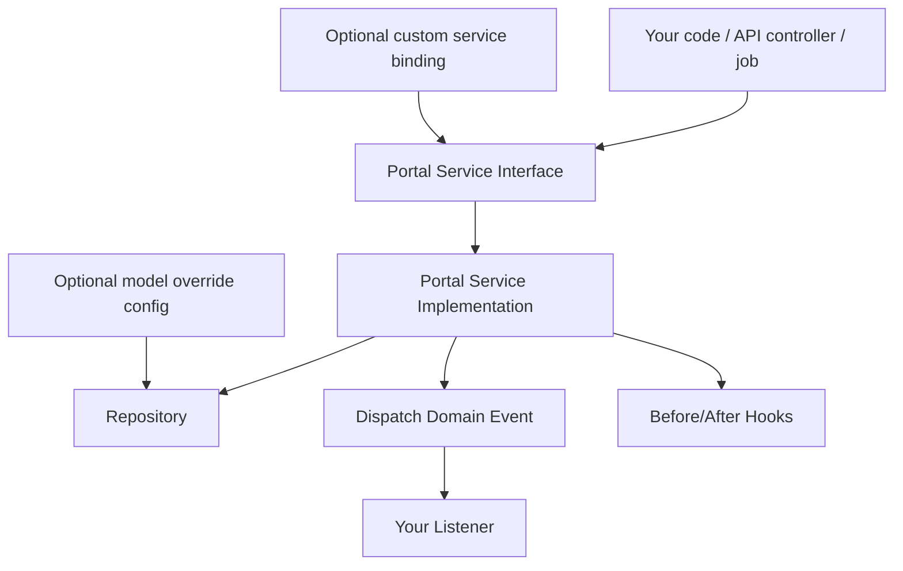

# Extending the Portal

This guide focuses on extending `ninjaportal/portal` safely while preserving upgradeability.

## The extension hierarchy (recommended)

When you need custom behavior, prefer these in order:

1. **Events / listeners** for side effects
2. **Service replacement/decorators** for business logic changes
3. **Observers** for model lifecycle hooks
4. **Model overrides** for schema/relationship/cast changes

This keeps the core package stable and makes upgrades easier.

## Extension flow (visual)

## Pattern 1: Add listeners (preferred for side effects)

Use listeners for:

- webhooks
- analytics
- notifications
- external syncs

Why this is the best first choice:

- no service/controller changes
- highly upgrade-friendly
- preserves package flow and contracts

See:

- [Portal / Hooks & Events](/portal/hooks-events)
- [References / Events Catalog](/reference/events)

## Pattern 2: Replace a service implementation

Use this when you need to change business rules (not just add side effects).

Examples:

- tenant-specific validation rules
- enterprise-specific user/product constraints
- custom workflow gating

Implementation steps:

1. extend or reimplement the service class
2. bind your implementation to the package service interface
3. preserve event dispatch behavior in your custom service

Example patterns:

- [Introduction / How to Use](/introduction/how-to-use)
- [Portal / How to Extend (Reference)](/portal/extending)

## Pattern 3: Register observers

Use observers for Eloquent lifecycle reactions like:

- indexing/search sync
- cache invalidation
- derived data maintenance

NinjaPortal provides `BasePortalServiceProvider` to make listener/observer registration cleaner in your project/extensions.

## Pattern 4: Override models via config

Use model overrides when you need:

- custom relationships
- extra casts/attributes
- application-specific behaviors on core models

Configure `config/ninjaportal.php` `models.*`, then confirm:

- repository bindings resolve the custom model
- policies still match the expected behavior
- API validation/model resolution remains correct (if `portal-api` depends on the model)

## What to avoid

- editing package internals for application-specific rules
- moving side effects into controllers
- bypassing services when business rules/events matter

