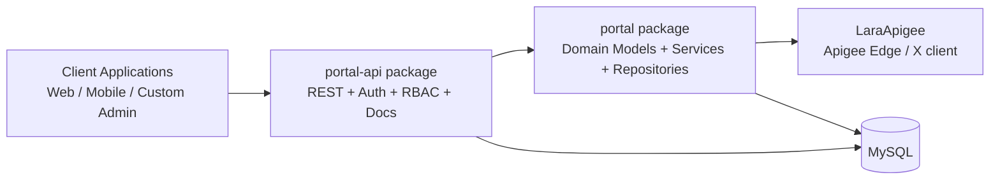
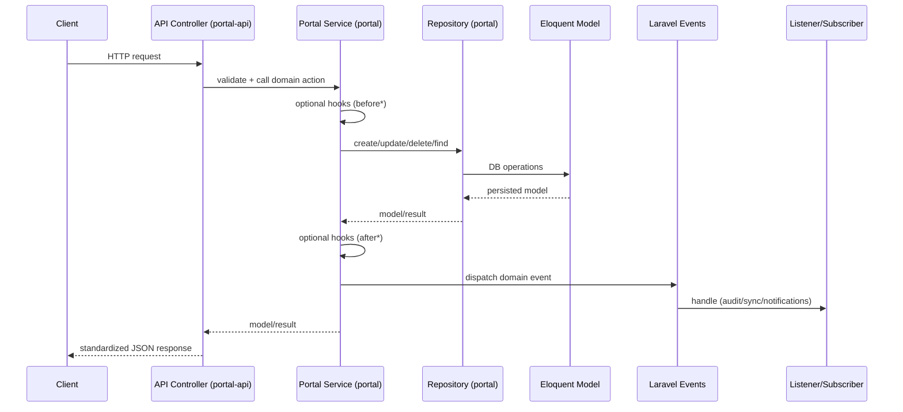

# Architecture

## High-level package architecture

## Backend layering

### Laravel application

The application is the runtime container. It provides:

- environment configuration (`.env`)
- framework bootstrapping
- package discovery / loading
- app-specific overrides and extensions
- deployment/runtime concerns

### `ninjaportal/portal` (core)

The core package defines:

- Eloquent models (users, admins, categories, API products, menus, settings, audiences)
- repositories (data access)
- services (business logic)
- domain events
- policies (RBAC authorization integration)
- translation system (`HasTranslations`)

### `ninjaportal/portal-api`

The API package provides:

- versioned API routes (`api/v1`)
- JSON response contract and API request helpers
- JWT access + opaque refresh token flow
- admin and consumer auth endpoints
- RBAC middleware composition for admin endpoints
- policy authorizer abstraction
- activity logging subscriber and storage
- Scribe integration for endpoint reference docs

## Request-to-domain flow (CRUD path)

## Authentication extensibility note

Authentication behavior is exposed behind interfaces in `portal-api`, which makes the auth flow replaceable/decoratable without changing controller signatures.

See [Deepdive / Add Custom Auth Flow](/deepdive/custom-auth-flow).
