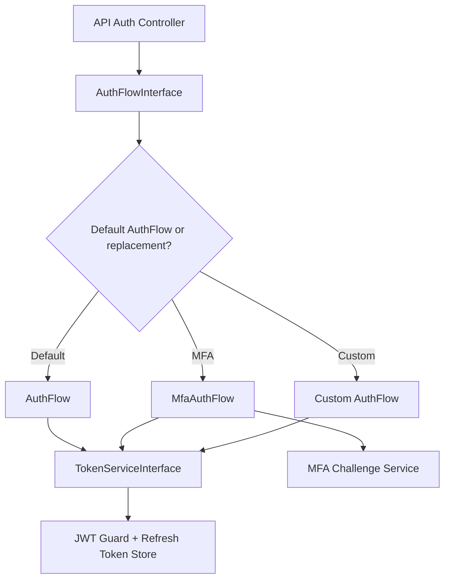

# Extending Portal API

Portal API was designed to be replaceable at key seams without forking controllers.

## Primary extension points

### 1. Replace `AuthFlowInterface`

Use this to change login behavior (MFA, SSO, step-up auth, risk scoring, custom login constraints).

Current examples:

- default: `NinjaPortal\Api\Auth\AuthFlow`
- MFA package: `NinjaPortal\Mfa\Auth\MfaAuthFlow`

### 2. Replace `TokenServiceInterface`

Use this to customize token issuance/storage behavior.

Examples:

- custom token claims
- alternate refresh token persistence rules
- external token service integration

### 3. Replace `ApiAuthorizerInterface`

Default implementation calls Laravel Gate (`PolicyApiAuthorizer`).

Replace this when you need:

- ABAC/tenant-aware authorization
- policy engine integration (OPA/Casbin/custom)
- custom auditing around authorization failures

### 4. Configure models/guards via `PortalApiContext`

No code replacement required for many cases.

Use config/env to change:

- consumer model
- admin model
- consumer/admin guards

## Example: replacing the auth flow (custom SSO pre-check)

```php
namespace App\Auth;

use NinjaPortal\Api\Contracts\Auth\AuthFlowInterface;
use Illuminate\Contracts\Auth\Authenticatable;

class CustomAuthFlow implements AuthFlowInterface
{
    public function __construct(private AuthFlowInterface $inner) {}

    public function attemptLogin(string $email, string $password, string $context): array
    {
        // Example: block password login for certain domains, redirect to SSO flow
        if ($context === 'admin' && str_ends_with(strtolower($email), '@corp.example')) {
            throw \Illuminate\Validation\ValidationException::withMessages([
                'email' => ['Use enterprise SSO for this account.'],
            ]);
        }

        return $this->inner->attemptLogin($email, $password, $context);
    }

    public function issueForUser(Authenticatable $user, string $context): array
    {
        return $this->inner->issueForUser($user, $context);
    }

    public function refresh(string $refreshToken, string $context): array
    {
        return $this->inner->refresh($refreshToken, $context);
    }

    public function logout(string $refreshToken, string $context): void
    {
        $this->inner->logout($refreshToken, $context);
    }
}
```

Bind it in your app/provider:

```php
use NinjaPortal\Api\Contracts\Auth\AuthFlowInterface;
use NinjaPortal\Api\Auth\AuthFlow;
use App\Auth\CustomAuthFlow;

$this->app->bind(AuthFlowInterface::class, function ($app) {
    return new CustomAuthFlow($app->make(AuthFlow::class));
});
```

> If `portal-mfa` is installed and you want to extend *that* behavior, decorate `MfaAuthFlow` instead of `AuthFlow`.

## Example: custom API authorizer

```php
use NinjaPortal\Api\Contracts\Authorization\ApiAuthorizerInterface;

class TenantAwareAuthorizer implements ApiAuthorizerInterface
{
    public function authorize(string $ability, mixed $arguments = []): void
    {
        // run tenant checks, then delegate to Gate or throw AuthorizationException
    }
}
```

Bind it:

```php
$this->app->bind(ApiAuthorizerInterface::class, TenantAwareAuthorizer::class);
```

## Auth extension flow diagram


