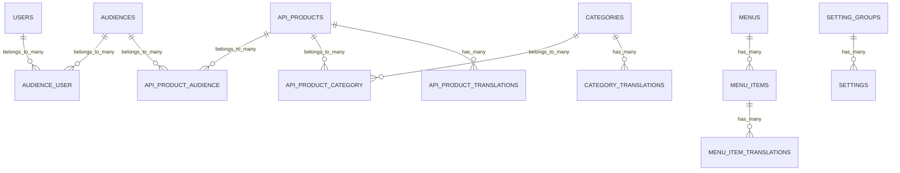

# Portal: DB Design

This page explains the database design of `ninjaportal/portal` tables and how the schema is organized by domain concern.

For the complete platform-wide schema reference (including `portal-api` and `portal-mfa` tables), see [Reference / Database Schema](/reference/database-schema).

## Design goals

The Portal schema is designed to support:

- a local portal catalog and content model
- translatable fields using companion translation tables
- audience-based access grouping
- runtime settings storage with typed values
- compatibility with API and extension packages layered on top

## Domain clusters

### 1. Identity & access-related domain tables

- `users`
- `password_reset_tokens`
- `sessions`

Notes:

- `users` is the default consumer/developer model used by Portal and (by default) Portal API
- audience membership is modeled through `audience_user`
- admin auth model exists in the package domain model layer, but admin auth/token storage is handled by `portal-api`

### 2. Catalog and taxonomy

- `api_products`
- `api_product_translations`
- `categories`
- `category_translations`
- `api_product_category` (pivot)

Pattern:

- the base table stores stable identifiers / non-localized attributes
- the `*_translations` table stores locale-specific fields
- many-to-many pivots connect products to categories

## 3. Audience access modeling

- `audiences`
- `api_product_audience` (pivot)
- `audience_user` (pivot)

This enables:

- assigning users to audiences
- assigning API products to audiences
- deriving catalog visibility/business rules from audience relationships

## 4. Navigation/content structures

- `menus`
- `menu_items`
- `menu_item_translations`

This supports multi-locale menu rendering while keeping menu identity stable across locales.

## 5. Runtime settings

- `setting_groups`
- `settings`

Key ideas:

- `settings` stores typed values (`type` + `value`)
- grouping is optional via `setting_group_id`
- `SettingService` is responsible for casting and cache-aware reads

## Translation table pattern (important)

Portal uses a consistent translation model pattern:

- one base model table
- one translation table with:
  - `{parent_id}` FK
  - `locale`
  - localized fields
  - unique constraint on (`{parent_id}`, `locale`)

Benefits:

- clear locale isolation
- predictable querying/loading
- reusable `HasTranslations` behavior across models

See [Portal / Translations](/portal/translations) for implementation details and how to apply this to your own models.

## Relationship overview (core portal domain)

## Practical schema conventions to preserve in customizations

If you extend the schema in your application:

- keep translation-table naming consistent (`*_translations`)
- keep locale uniqueness constraints
- use pivots for many-to-many feature assignments (instead of embedding arrays)
- add indices for high-cardinality lookup columns (`slug`, foreign keys, token hashes, timestamps)
- document any added fields if they change API responses or policy behavior
