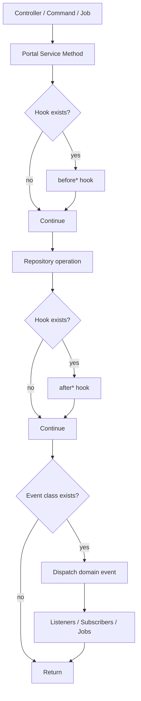

# Hooks & Events (Portal Core)

Portal core is designed to be extended in two complementary ways:

1. **Service hooks** (override a service class and implement `before*/after*` methods)
2. **Domain events** (listen to built-in events without replacing service code)

Use hooks when you need to alter service behavior inline. Use events when you want add-on behavior after the domain action completes.

## How CRUD hooks work

`CrudOperationsTrait` calls hooks around repository operations when hook methods exist on the service:

- `beforeCreate(array $data)`
- `afterCreate(Model $item)`
- `beforeUpdate(mixed $item, array $data)`
- `afterUpdate(Model $item, array $data)`
- `beforeDelete(Model $item)`
- `afterDelete(Model $item)`
- `beforeRestore(Model $item)`
- `afterRestore(Model $item, bool $restored)`

These are invoked through `ServiceHooksAwareTrait::callHook()`.

## How automatic event firing works

`FireEventsTrait` computes canonical event class names using model name + action and dispatches them when the class exists.

Examples:

- `Category` + `created` => `NinjaPortal\Portal\Events\Category\CategoryCreatedEvent`
- `Setting` + `updated` => `NinjaPortal\Portal\Events\Setting\SettingUpdatedEvent`

## Extension flow diagram (hooks + events)



## Example 1: Extending a service with hooks

Use case: normalize category slugs and push metrics after creation.

```php
namespace App\Portal\Services;

use Illuminate\Support\Str;
use NinjaPortal\Portal\Services\CategoryService;

class CustomCategoryService extends CategoryService
{
    protected function beforeCreate(array $data): void
    {
        // validate or inspect incoming data (side effects optional)
    }

    protected function mutateDataBeforeCreate(array $data): array
    {
        if (isset($data['slug'])) {
            $data['slug'] = Str::slug($data['slug']);
        }

        return $data;
    }

    protected function afterCreate($category): void
    {
        // trigger custom metrics, cache warming, etc.
    }
}
```

Bind it in your app provider:

```php
use NinjaPortal\Portal\Contracts\Services\CategoryServiceInterface;
use App\Portal\Services\CustomCategoryService;

$this->app->singleton(CategoryServiceInterface::class, CustomCategoryService::class);
```

## Example 2: Extending behavior with events (recommended for add-ons)

Use case: send a webhook whenever an API product is updated.

```php
namespace App\Listeners;

use NinjaPortal\Portal\Events\ApiProduct\ApiProductUpdatedEvent;

class SendApiProductWebhook
{
    public function handle(ApiProductUpdatedEvent $event): void
    {
        $product = $event->apiProduct;

        // Dispatch a job / call webhook client
    }
}
```

Register in your app using `BasePortalServiceProvider`:

```php
namespace App\Providers;

use NinjaPortal\Portal\Providers\BasePortalServiceProvider;
use NinjaPortal\Portal\Events\ApiProduct\ApiProductUpdatedEvent;
use App\Listeners\SendApiProductWebhook;

class NinjaPortalExtensionServiceProvider extends BasePortalServiceProvider
{
    protected $listen = [
        ApiProductUpdatedEvent::class => [
            SendApiProductWebhook::class,
        ],
    ];
}
```

## When to choose hooks vs events

### Choose hooks when

- you must alter/validate the service behavior itself
- you need to run code before repository persistence
- you are replacing a service implementation intentionally

### Choose events when

- you are adding side effects (notifications, audit integrations, webhooks)
- you want to avoid replacing core bindings
- you are building a package/add-on with loose coupling

## Built-in events

See the full catalog in [Reference / Events Catalog](/reference/events).
