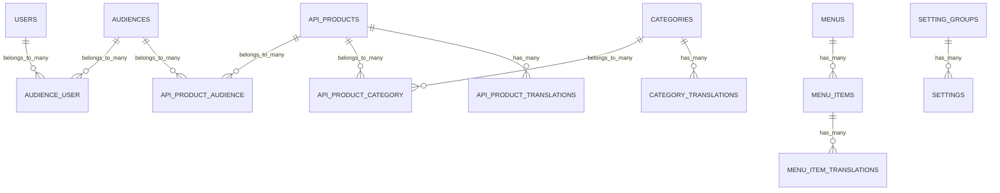

# Database Schema Reference

This page documents the database tables created by the NinjaPortal backend packages covered in this docs set.

## Scope of this schema reference

Included:

- `ninjaportal/portal` tables
- `ninjaportal/portal-api` tables
- `ninjaportal/portal-mfa` tables

Not included in detail:

- Laravel framework default tables not owned by these packages (except where Portal migrations create/modify them)
- Spatie Permission tables (roles/permissions pivots), which come from the upstream package migrations
- LaraApigee / external Apigee-managed data

## High-level relationship diagram (core portal domain)

## Portal schema (`ninjaportal/portal`)

## `users`

Portal developer/consumer accounts.

Key columns:

- `id`
- `first_name`
- `last_name`
- `email` (unique)
- `password`
- `status` (default updated by migration to `pending` in newer migration)
- `sync_with_apigee` (bool)
- `custom_attributes` (json)
- `email_verified_at`
- timestamps

Notes:

- Used by Portal core and `portal-api` consumer auth (by default)
- Audience memberships are stored in `audience_user`

## `password_reset_tokens`

Password reset token storage (created by Portal migration in this package context).

Key columns:

- `email` (PK)
- `token`
- `created_at`

## `sessions`

Session storage table (created by Portal migration in this package context).

Key columns:

- `id` (PK)
- `user_id` (nullable, indexed)
- `ip_address`
- `user_agent`
- `payload`
- `last_activity`

## `categories`

API product taxonomy categories.

Key columns:

- `id`
- `slug` (unique)
- timestamps

Relations:

- many-to-many with `api_products`
- has many `category_translations`

## `category_translations`

Localized fields for categories.

Key columns:

- `id`
- `category_id` (FK, cascade delete)
- `locale` (indexed)
- `name`
- `description` (nullable)
- `short_description` (nullable)
- `thumbnail` (nullable)
- unique (`category_id`, `locale`)
- timestamps

## `api_products`

Portal catalog records representing Apigee products.

Key columns:

- `id`
- `slug` (unique)
- `apigee_product_id` (unique)
- `swagger_url` (nullable)
- `integration_file` (nullable)
- `visibility` (string; typically `public|private|draft`)
- `tags` (json, nullable)
- `custom_attributes` (json, nullable)
- timestamps

Relations:

- many-to-many with `categories`
- many-to-many with `audiences`
- has many `api_product_translations`

## `api_product_translations`

Localized fields for API products.

Key columns:

- `id`
- `api_product_id` (FK, cascade delete)
- `locale` (indexed)
- `name`
- `description` (longText, nullable)
- `short_description` (longText, nullable)
- `thumbnail` (longText, nullable)
- unique (`api_product_id`, `locale`)
- timestamps

## `menus`

Portal navigation menus.

Key columns:

- `id`
- `slug` (unique)
- timestamps

Relations:

- has many `menu_items`

## `menu_items`

Menu items linked to a menu.

Key columns:

- `id`
- `slug` (unique)
- `menu_id` (FK, cascade delete)
- timestamps

Relations:

- belongs to `menu`
- has many `menu_item_translations`

## `menu_item_translations`

Localized menu item content/route metadata.

Key columns:

- `id`
- `menu_item_id` (FK, cascade delete)
- `locale`
- `title`
- `url` (nullable)
- `route` (nullable)
- unique (`menu_item_id`, `locale`)
- timestamps

## `api_product_category` (pivot)

Many-to-many pivot between API products and categories.

Key columns:

- `id`
- `api_product_id` (FK, cascade delete)
- `category_id` (FK, cascade delete)
- timestamps

## `audiences`

Logical groupings of users/developers.

Key columns:

- `id`
- `name` (unique)
- timestamps

Relations:

- many-to-many with `users`
- many-to-many with `api_products`

## `api_product_audience` (pivot)

Many-to-many pivot between API products and audiences.

Key columns:

- `id`
- `audience_id` (FK, cascade delete)
- `api_product_id` (FK, cascade delete)
- unique (`audience_id`, `api_product_id`)
- timestamps

## `audience_user` (pivot)

Many-to-many pivot between users and audiences.

Key columns:

- `id`
- `user_id` (FK, cascade delete)
- `audience_id` (FK, cascade delete)
- timestamps

## `setting_groups`

Groups for organizing settings shown/managed in the portal.

Key columns:

- `id`
- `name` (unique)
- timestamps

## `settings`

Typed runtime settings store.

Key columns:

- `id`
- `key` (unique)
- `value` (text, nullable)
- `label` (nullable)
- `type` (enum of supported setting types)
- `setting_group_id` (nullable FK to `setting_groups`)
- timestamps

Notes:

- `SettingService` handles typed casting and caching
- `SettingObserver` can keep runtime settings cache/state synchronized when registered

## Portal API schema (`ninjaportal/portal-api`)

## `portal_api_refresh_tokens`

Opaque refresh token store for admin + consumer JWT auth.

Key columns:

- `id`
- `context` (`consumer|admin`)
- `token_hash` (sha256 hash, unique)
- `tokenable_type`
- `tokenable_id`
- `expires_at` (indexed)
- `revoked_at` (nullable, indexed)
- timestamps
- composite index on (`tokenable_type`, `tokenable_id`, `context`)

Notes:

- raw refresh tokens are never stored
- tokens are rotated on refresh

## `portal_api_activity_logs`

Audit trail entries for critical actions.

Key columns:

- `id`
- `action`
- actor fields:
  - `actor_type`
  - `actor_id`
  - `actor_name`
  - `actor_email`
- subject fields:
  - `subject_type`
  - `subject_id`
  - `subject_label`
- request metadata:
  - `ip`
  - `user_agent`
- `properties` (json)
- timestamps
- `created_at` indexed

Notes:

- Populated asynchronously via `RecordActivityJob`
- Driven by `PortalDomainActivitySubscriber`

## Portal MFA schema (`ninjaportal/portal-mfa`)

## `portal_mfa_profiles`

One MFA profile per authenticatable actor (consumer/admin user model instance).

Key columns:

- `id`
- `authenticatable_type`, `authenticatable_id` (morph)
- `is_enabled`
- `preferred_driver` (nullable)
- `settings` (json, nullable)
- timestamps
- unique actor morph pair

Purpose:

- stores user-level MFA preference state independent from factor rows

## `portal_mfa_factors`

Configured MFA factors for an actor.

Key columns:

- `id`
- `authenticatable_type`, `authenticatable_id` (morph)
- `driver`
- `label`
- `secret_encrypted` (nullable; used by authenticator driver)
- `is_enabled`
- `is_verified`
- `is_primary`
- `config` (json)
- `verified_at`
- `last_used_at`
- timestamps
- unique actor + driver

Purpose:

- stores per-driver enrollment state and driver-specific configuration

## `portal_mfa_challenges`

Ephemeral MFA challenges (login and factor enrollment verification).

Key columns:

- `id`
- `token_hash` (unique; raw challenge token is not stored)
- `context` (`consumer|admin`)
- `purpose` (e.g. `login`, `factor_email_enrollment`)
- `authenticatable_type`, `authenticatable_id` (morph)
- `mfa_factor_id` (nullable FK to `portal_mfa_factors`)
- `driver`
- `code_hash` (nullable; for OTP-based challenges)
- attempt/resend controls:
  - `attempts`
  - `max_attempts`
  - `resend_count`
  - `max_resends`
- challenge lifecycle timestamps:
  - `last_sent_at`
  - `expires_at`
  - `completed_at`
  - `invalidated_at`
- `payload` (json)
- `meta` (json)
- timestamps

Purpose:

- login MFA challenge verification
- email OTP enrollment verification
- auditability + replay protection state

## Schema evolution notes

- Portal schema includes additive migrations for API product metadata (`integration_file`, `tags`, `custom_attributes`).
- Portal user status default changed in a later migration (`update_users_status_default_to_pending`).
- Package docs should be reviewed when new package migrations are added so this page stays current.
