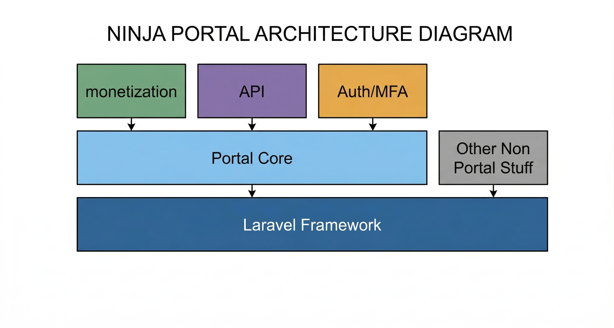

::: warning
The documentation is still a work in progress, and we are actively working on it, if you have any questions or need help, please don't
hesitate to reach out to us on our [GitHub repository](https://github.com/ninjaportal/docs)
:::

# Introduction
NinjaPortal is a Laravel based developer portal that's built for Apigee API Management, 
It provides an enterprise grade ready solution that's easy to be customized and extended to meet your needs.

## Anatomy of NinjaPortal
The NinjaPortal project is structured in a layered architecture, with each layer responsible for a specific aspect, this structure promotes separation of concerns and makes it easier to maintain and extend the application.    




# How it's built

NinjaPortal works by integrating with Apigee's API Management platform to provide a seamless experience, we built our own custom Apigee client to interact with Apigee's API, 
and it's designed to be flexible and extensible, allowing you to customize it to meet your specific needs even outside NinjaPortal's core features.

The NinjaPortal consists of a core package that provides the main functionality of the portal, and a set of other packages that provide additional features and integrations.
We built it this way to be tailored to your needs, as some people may only need the core and they will build their own APIs/Contracts, and some may need the official API package so they can install it and use it, and some may need to use it like traditional Laravel app with blade frontend, so these people will
install the ```shadow-theme``` package and not the portal-api package, this way we can provide a more flexible and customizable solution that can be tailored to different use cases and preferences.

