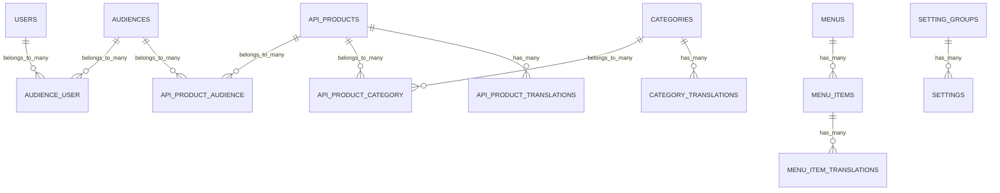

# DB Modelling
The `ninjaportal/portal` package owns the core database tables of NinjaPortal.

The idea is simple, we keep the portal data locally, and we only store the Apigee identifiers we need to connect this local data with Apigee.

So the database is not a copy of Apigee, it's the portal domain model.

## Main Domains
The database is split into a few clear areas.

## Developers
The `users` table represents the developer account in the portal.

It stores the normal account fields like:

- `first_name`
- `last_name`
- `email`
- `password`
- `status`
- `sync_with_apigee`
- `custom_attributes`

The `sync_with_apigee` flag is used by the package when the developer is created or updated in Apigee.

The user can also belong to one or more audiences using the `audience_user` pivot table.

## API Products
The `api_products` table represents the API products you want to show in the portal catalog.

It stores stable product data like:

- `slug`
- `apigee_product_id`
- `swagger_url`
- `integration_file`
- `visibility`
- `tags`
- `custom_attributes`

The important field here is `apigee_product_id`.
This is the link between the local portal product and the real product in Apigee.

Product content like name and description is stored in `api_product_translations`, because this content can change per locale.

## Categories
Categories are used to group API products in the portal.

The base table is `categories`, and the translated content is stored in `category_translations`.

The relation between products and categories is many-to-many through:

```text
api_product_category
```

This means the same API product can appear in more than one category.

## Audiences
Audiences are used to control who can see or use specific products.

The base table is:

```text
audiences
```

It connects to users through:

```text
audience_user
```

And connects to API products through:

```text
api_product_audience
```

So you can say:

- this developer belongs to this audience
- this API product is available for this audience

If an API product has no audience restriction, it can be treated as available to everyone depending on how your application layer uses the service.

## Menus
Menus are stored in:

```text
menus
menu_items
menu_item_translations
```

The menu itself has a stable `slug`.
The menu item title, URL, and route are translated, so the same menu can be rendered in different locales.

## Settings
Settings are stored in:

```text
setting_groups
settings
```

Settings are grouped so the admin panel can show them in a cleaner way.
Each setting has:

- `key`
- `value`
- `label`
- `type`
- `setting_group_id`

The package service layer handles reading and loading the settings, so you usually don't need to query this table directly.

## Translations Design
Portal doesn't store translated content as JSON on the main table.

Instead, it uses a separate translation table for every translated model.

For example:

```text
api_products
api_product_translations

categories
category_translations

menu_items
menu_item_translations
```

This keeps the main table stable and stores only locale based fields in the translation table.

A translation table usually has:

- the translated fields
- `locale`
- the parent model foreign key

The package uses the `HasTranslations` trait to read and write these translated fields.

## Relationship Overview
The core database shape looks like this:



## Why It's Designed This Way
The portal package keeps the database small and focused.

It stores the things the portal needs to own:

- developers
- local API catalog
- categories
- audiences
- menus
- settings
- translations

And it keeps Apigee specific operations behind services and listeners.

This gives you a Laravel friendly database, while still keeping the portal connected to Apigee.
